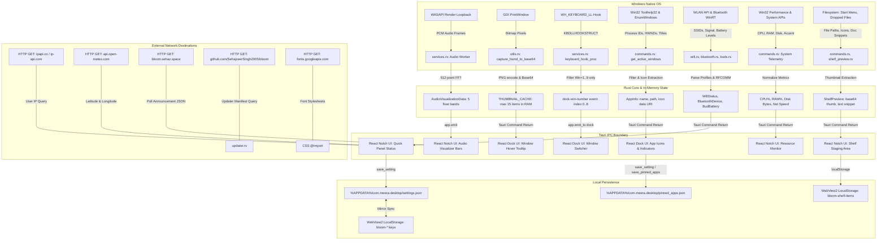

# MEERA — Comprehensive Data-Flow Inventory

**Target Application:** MEERA  
**Audit Directory:** `C:\project\BLOOM\audit`  
**Date:** October 30, 2026  

---

## 1. Overview

This document provides an exhaustive, field-level inventory of every data source accessed, collected, transformed, stored, or transmitted by MEERA. It traces data from its native origin point through intermediate memory buffers, Rust IPC pipelines, frontend state managers, local persistence files, and external network destinations.

---

## 2. End-to-End Data Flow Matrix

---

## 3. Data Source Inventories

### 3.1 Audio Data
- **Origin:** Windows Core Audio (WASAPI) — Default Render Console Endpoint (`eRender`, `eConsole`).
- **Initiator:** `src-tauri/src/services.rs: setup_audio_visualization()` (lines 660–935).
- **Trigger:** Background thread loop; actively processes audio packets when `ANY_MEDIA_PLAYING` atomic flag is set.
- **Data Captured:** 16-bit or 32-bit PCM audio stream of all sounds playing through the default Windows speaker output.
- **Transformation Pipeline:**
  1. `IAudioCaptureClient::GetBuffer()` receives audio frames.
  2. Samples are downmixed to mono float values.
  3. Windowed using a Hann window into a 512-sample buffer (`fft_buffer`).
  4. Transformed into frequency domain using `rustfft::FftPlanner` (`fft.process(&mut fft_input)`).
  5. Magnitudes grouped into 5 frequency sub-bands: `(1..2)`, `(2..6)`, `(6..18)`, `(18..60)`, `(60..200)`.
  6. Smoothed and scaled into 5 floating-point values clamped to `[0.18, 1.0]`.
  7. Emitted over Tauri IPC as event `"audio-visualization"` with struct `AudioVisualizationData { frequencies: Vec<f32> }`.
  8. Audio buffer is immediately freed with `capture_client.ReleaseBuffer()`.
- **Destination:** Notch UI React visualizer component (`src/App.tsx`).
- **Persistence:** **None**. Audio frames exist only in transient stack/heap buffers during the 32ms processing window.
- **Network Transmission:** **None**.
- **Microphone Audio:** **None**. No microphone recording or audio capture endpoint (`eCapture`) is initialized.

---

### 3.2 Screen and Window Data
- **Origin:** Win32 Desktop Windows Manager / GDI (`PrintWindow`, `GetDC`, `CreateCompatibleBitmap`).
- **Initiators:**
  1. `src-tauri/src/services.rs: setup_thumbnail_capture()` (lines 399–585) — listens for `EVENT_SYSTEM_FOREGROUND`.
  2. `src-tauri/src/commands.rs: capture_window_thumbnail()` (lines 3187–3235) — dock icon hover.
- **Data Captured:** Visual pixels of a specific target window HWND, downscaled to a maximum of 320x200 pixels.
- **Transformation Pipeline:**
  1. `PrintWindow(hwnd, hdc_mem, PW_RENDERFULLCONTENT)` captures the window to a memory bitmap.
  2. Downscaled to fit target dimensions while maintaining aspect ratio.
  3. Encoded to PNG byte slice in memory using the Rust `image` crate.
  4. Base64-encoded to a data URL string (`data:image/png;base64,...`).
  5. Stored in memory cache: `THUMBNAIL_CACHE: Mutex<HashMap<isize, (String, i64)>>`.
  6. Bounded to a maximum of 15 thumbnails (`MAX_CACHED_THUMBNAILS = 15`); oldest evicted on insertion.
- **Destination:** Dock UI hover preview card (`src/Dock.tsx`).
- **Persistence:** **None**. RAM only.
- **Network Transmission:** **None**.
- **Full Screen Desktop Duplication:** **None**.

---

### 3.3 Keyboard and Input Data
- **Origin:** Win32 Low-Level Keyboard Hook (`SetWindowsHookExW(WH_KEYBOARD_LL, ...)`).
- **Initiator:** `src-tauri/src/services.rs: setup_keyboard_hook()` (lines 43–224).
- **Trigger:** Active only when native Windows taskbar is hidden AND setting `bloom-dock-win-number-enabled` is `"true"`.
- **Data Inspected:** Key press virtual-key codes (`vkCode`).
- **Filtering Logic:**
  - Checks if `vkCode == VK_LWIN` or `VK_RWIN`.
  - If Win key is held down, checks if `vkCode` is in range `0x31..=0x39` (top-row numbers 1–9).
  - If a match is found:
    1. Injects a dummy Start Menu mask key (`VK_0xFF` / unassigned VK) to prevent Windows Start Menu activation.
    2. Emits Tauri event `"dock-win-number"` to the dock window with the target slot index (`0..8`).
    3. Consumes the key event (returns `1`).
  - If key is NOT `Win + 1..9`:
    - Immediately calls `CallNextHookEx()`.
    - No buffering, logging, or state retention occurs.
- **Destination:** Dock UI app switcher (`src/Dock.tsx`).
- **Persistence:** **None**.
- **Network Transmission:** **None**.

---

### 3.4 Clipboard Data
- **Origin:** `@tauri-apps/plugin-clipboard-manager`.
- **Initiator:** `src/App.tsx` (lines 1768–1775).
- **Operation:** `writeText(item.text)` when user clicks on a text snippet stored in the Notch Shelf.
- **Clipboard Monitoring:** **None**. The app does not install clipboard format listeners (`AddClipboardFormatListener`) and does not read the clipboard in the background.

---

### 3.5 Network, Wi-Fi, and Wireless Data
- **Origin:** Windows Native WLAN API (`wlanapi.dll`), Windows Runtime Bluetooth APIs (`Windows.Devices.Bluetooth`), Win32 IP Helper (`iphlpapi.dll`).
- **Components:** `src-tauri/src/wifi.rs`, `bluetooth.rs`, `buds.rs`, `commands.rs`.
- **Data Collected:**
  - Wi-Fi: Interface GUIDs, list of visible SSID names, BSS types, signal qualities (0–100%), authentication algorithms (WPA2, WPA3), connection status, profile names.
  - Wi-Fi Passwords: User enters password in Quick Panel (`WifiPanel.tsx`); password string passed across Tauri IPC to `wifi_connect(ssid, password)`. Converted to Windows XML profile string (`profile_xml`) and submitted directly to OS via `WlanSetProfile`.
  - Bluetooth: Device ID strings, friendly device names, device class codes, connection state, paired state.
  - Earbuds / Headset Telemetry: Reads vendor-specific battery levels (left bud %, right bud %, case %) via Bluetooth RFCOMM socket channels for Samsung Galaxy Buds and Apple AirPods.
  - Network Speed: Reads interface octets via `GetIfTable2()` to calculate upstream and downstream bytes per second.
- **Persistence:**
  - Wi-Fi passwords: **Never stored** in MEERA files or settings. Handed over to Windows WLAN profile store.
  - Bluetooth device looks: Custom device icons mapped to device names in `settings.json` under `"bloom-device-looks"`.
- **Network Transmission:** **None** of the wireless inventory is transmitted over external network connections.

---

### 3.6 Location, Geolocation, and Weather Data
- **Origin:** IP Geolocation APIs and User Settings.
- **Initiator:** `src/hooks/useWeather.ts` (lines 93–175), `src/settings/useSettings.ts` (lines 460–475).
- **Trigger:** Initial mount and recurring 30-minute interval timer.
- **Data Collected & Transmitted:**
  1. **User IP Address:** Exposed via HTTP requests to `https://ipapi.co/json/` and plaintext fallback `http://ip-api.com/json/`.
  2. **Location Response:** `{ lat: number, lon: number, city: string }`.
  3. **Coordinates Transmitted:** Query parameters `latitude=${latitude}&longitude=${longitude}` transmitted over HTTPS to `https://api.open-meteo.com/v1/forecast?...`.
  4. **City Search Transmitted:** Query parameter `name=${encodeURIComponent(cityName)}` transmitted over HTTPS to `https://geocoding-api.open-meteo.com/v1/search?...`.
- **Persistence:**
  - Persisted in `%APPDATA%/com.meera.desktop/settings.json`:
    - `"bloom-weather-city"`
    - `"bloom-weather-lat"`
    - `"bloom-weather-lon"`
    - `"bloom-weather-cached-temp"`
    - `"bloom-weather-cached-condition"`
  - Mirrored in WebView2 `localStorage`.

---

### 3.7 Remote Announcements
- **Origin:** `https://bloom.sehaz.space/announcements.json`.
- **Initiator:** `src/hooks/useAnnouncement.ts` (lines 13–64).
- **Trigger:** On application mount, and every 60 minutes thereafter.
- **Data Flow:**
  1. Webview issues HTTP GET request to `bloom.sehaz.space`.
  2. Parses JSON object: `{ id: string, title: string, severity: string, body: string, url?: string }`.
  3. Caches payload in `localStorage` under `"bloom-announcement-cache"` and timestamp under `"bloom-announcement-cache-at"`.
  4. Dismissal recorded in `localStorage` under `"bloom-announcement-dismissed"`.
  5. Renders announcement banner in Island / Notch and Settings.
- **Metadata Exfiltration:** Discloses user client IP, User-Agent, and operational uptime/frequency to third-party personal host `sehaz.space`.

---

### 3.8 Auto-Update Data Flow
- **Origin:** `https://github.com/SehajveerSingh2005/bloom/releases/latest/download/latest.json`.
- **Initiator:** `src-tauri/src/updater.rs: check()`, `run_startup_check()` (lines 139–298).
- **Trigger:** Application startup (background check) or user clicking "Check for Updates" in Settings.
- **Data Flow:**
  1. Requests `latest.json` release manifest via HTTPS from GitHub.
  2. Manifest returns `{ version, pub_date, url, signature }`.
  3. Verifies Ed25519/minisign signature using hardcoded public key in `tauri.conf.json`.
  4. Persists check timestamp and state in `%APPDATA%/com.meera.desktop/update-state.json`.
  5. If `bloom-auto-update` is `"true"` and release is >= 24 hours old:
     - Downloads binary payload into RAM.
     - Hands bytes to NSIS installer execution via Tauri updater plugin.
     - Shuts down application and launches installer.

---

### 3.9 Filesystem and Application State
- **Origin:** Windows Shell, Start Menu, Registry, and User File Drops.
- **Components:** `src-tauri/src/commands.rs`, `shelf_preview.rs`, `dock_extras.rs`.
- **Data Collected:**
  - Installed applications: Enumerates `.lnk` and UWP entries in `C:\ProgramData\Microsoft\Windows\Start Menu\Programs` and `%APPDATA%\Microsoft\Windows\Start Menu\Programs`.
  - Active windows: Enumerate top-level HWNDs, window title text, executable file paths, and application icons.
  - Shelf files: When user drags and drops a file onto the Notch Shelf:
    - Text files (`.txt`, `.json`, `.csv`, `.md`, `.js`, etc.): Reads first 64 KB of text for UI preview.
    - Images (`.png`, `.jpg`, `.webp`): Decodes 256x256 thumbnail into base64 PNG data URL.
    - PDF documents: Extracts cover thumbnail using Windows `Data_Pdf`.
    - Office documents (`.docx`, `.pptx`): Unzips embedded `docProps/thumbnail.jpeg` from file archive.
- **Persistence:**
  - Installed app icons: Cached as base64 in `%APPDATA%/com.meera.desktop/icon_cache.json`.
  - Pinned apps: Stored in `%APPDATA%/com.meera.desktop/pinned_apps.json`.
  - Shelf items: If `bloom-shelf-persist` is enabled, file paths and snippet contents are stored in WebView2 `localStorage` under `"bloom-shelf-items"`.
- **Network Transmission:** **None**.

---

## 4. Summary of Data Storage Locations

| File / Storage Path | Storage Format | Encryption | Sensitivity | Retention Policy |
| :--- | :--- | :--- | :--- | :--- |
| `%APPDATA%\com.meera.desktop\settings.json` | JSON | None | Medium (lat/lon, city, custom paths) | Retained until user reset/uninstall |
| `%APPDATA%\com.meera.desktop\update-state.json` | JSON | None | Low (version history, check times) | Retained indefinitely |
| `%APPDATA%\com.meera.desktop\pinned_apps.json` | JSON | None | Low (list of pinned app paths) | Retained until unpinned |
| `%APPDATA%\com.meera.desktop\icon_cache.json` | JSON | None | Low (base64 cached application icons) | Cleared via settings command |
| `%APPDATA%\com.meera.desktop\custom_icons\` | PNG & JSON | None | Low (user-selected replacement icons)| Retained until icon reset |
| `%LOCALAPPDATA%\com.meera.desktop\EBWebView\...` | LevelDB / SQLite | None | Medium (localStorage mirrors all settings) | Governed by WebView2 profile |
| `%TEMP%\taskbar-restore.marker` | Plain text | None | Low (internal PID and crash recovery flag) | Deleted on clean application exit |
